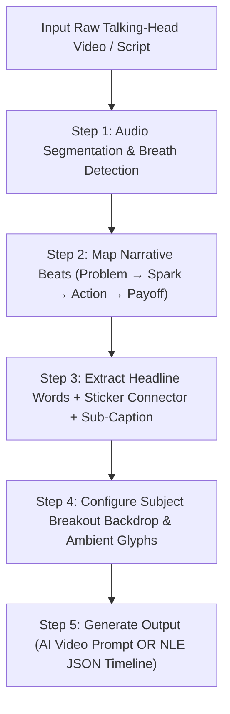

# Caption Style Edit: Pop-Out Kinetic Backdrop & Tape-Sticker Video Engine

## 1. System Overview & Aesthetic Philosophy

This skill codifies the **Pop-Out Kinetic Backdrop & Tape-Sticker Caption Style** (popularized by top-tier creator editors like Divyansh FX, Ali Abdaal, and modern SaaS launch creators) into an automated prompt engine and edit blueprint generator.

It transforms standard raw talking-head footage into high-retention, hyper-engaging vertical short-form video (9:16) with vibrant pop-out framing, tactile sticker physics, and ultra-crisp typography.

```
┌──────────────────────────────────────────────────────────┐
│                   [ AMBIENT 3D GLYPHS ]                  │
│                     (Lightbulb / Sparks)                 │
│                                                          │
│                   Ideas                                  │
│                   Aren't      ┌──────────┐               │
│                   Created     │   just   │ ◄─── Tilted   │
│                               └──────────┘      Sticker  │
│                                                          │
│               ┌───────────────────────┐                  │
│               │     [HEAD POP-OUT]    │                  │
│               │   ┌───────────────┐   │                  │
│               │   │ Vibrant Teal  │   │                  │
│               │   │ Geometric Card│   │                  │
│               │   └───────────────┘   │                  │
│               │    [FEET BREAKOUT]    │                  │
│               └───────────────────────┘                  │
│                                                          │
│     Ideas are sparks of imagination                      │
│     that shape thoughts into possibilities.              │
└──────────────────────────────────────────────────────────┘
```

### Core Architectural Pillars:

1. **High-Key Studio Canvas with Ambient 3D Glyphs**:
   - Clean, luminous white to soft-off-white background (`#FFFFFF` to `#F8FAFC`).
   - Floated with subtle, soft-blurred 3D ambient illustrative glyphs (lightbulbs, gear wheels, spark bursts, floating cursor arrows, data pills) that gently drift on a continuous `sine.inOut` loop.
2. **Rotoscoped Subject & 3D "Breakout" Container Card**:
   - The speaker/subject is cleanly segmented (rotoscoped / depth-masked).
   - Positioned over a vibrant rounded-corner geometric container (Teal `#00A896`, Electric Cobalt `#2563EB`, Sunset Tangerine `#F97316`, or Rich Violet `#7C3AED`).
   - **3D Pop-Out Breakout Illusion**: The subject's head/hair overlaps the top border and legs/chair break through the bottom/lateral boundaries, creating an unmistakable physical depth illusion.
3. **Multi-Tiered High-Contrast Headline Typography**:
   - **Tier 1 (Hook / Concept)**: Styled in an expressive, vibrant accent color or playful geometric sans (`#00A896`, `#0284C7`).
   - **Tier 2 & 3 (Core Anchor Words)**: Massive, ultra-bold black sans-serif typography (`#0A0A0A`, Inter Black / Montserrat ExtraBold / Arial Black / Anton) rendered with letter-split pop-in or scale-snap impact.
4. **The Tilted Yellow Tape-Sticker Connector**:
   - Bright canary/cyber yellow pill or tape badge (`#FFE600` / `#FACC15`) with rounded corners and subtle drop shadow (`rgba(0,0,0,0.12)`).
   - Tilted at an energetic angle (`-12°` to `+16°`) overlapping the primary headline.
   - Houses punchy connector words (`"just"`, `"never"`, `"always"`, `"secret"`, `"only"`, `"step 1"`).
   - Drops in with physical spring/elastic bounce physics (`back.out(2.2)` or `elastic.out(1, 0.4)`).
5. **Two-Tone Lower Context Sub-Caption**:
   - Positioned in the lower-third with clean, light-to-medium sans-serif typography.
   - Base narrative text in neutral slate gray (`#334155`), with key conceptual phrases highlighted in matching primary accent color (`#00A896`).

---

## 2. Color Palette & Component Tokens

| Token | Hex / RGBA | Role / Usage |
| :--- | :--- | :--- |
| **`--bg-canvas`** | `#FFFFFF` / `#F8FAFC` | High-key bright clean studio canvas background. |
| **`--card-teal`** | `#00A896` / `#008080` | Default vibrant subject backdrop container & accent headline. |
| **`--card-cobalt`** | `#2563EB` | Tech / Engineering variant backdrop container. |
| **`--card-coral`** | `#FF5757` / `#EA580C` | Bottleneck / Problem / Urgency variant container. |
| **`--sticker-yellow`**| `#FFE600` / `#FACC15` | Tilted connector tape sticker with black bold text. |
| **`--headline-black`** | `#0A0A0A` / `#000000` | Ultra-heavy bold sans-serif anchor words. |
| **`--sub-caption-gray`**| `#475569` | Secondary context sentence base text. |
| **`--sub-highlight`** | `#00A896` / `#0284C7` | Key phrase emphasis inside the sub-caption. |
| **`--glyph-tint`** | `rgba(0, 168, 150, 0.18)`| Ambient floating background glyphs (soft blur). |

---

## 3. Motion Physics & Animation Principles

* **Subject Card Pop-In**: `scale: 0.85 → 1.0` + `translateY: 40px → 0px` via `expo.out` (0.45s).
* **Kinetic Headline Reveal**: Letter-by-letter or word-by-word spring scale (`back.out(1.8)`, duration 0.35s).
* **Tape Sticker Drop-Slap**: `scale: 1.4 → 1.0`, `rotation: -25° → -12°` via `back.out(2.4)` (0.28s) + subtle camera micro-shake on impact.
* **Ambient Floating Glyphs**: Continuous slow sway (`translateY: -8px ↔ +8px`, `sine.inOut`, 2.4s cycle).
* **Camera Reframing**: Micro punch zooms (`100% → 108%`) on key spoken emphases, snapping to dead-still holds.

---

## 4. End-to-End Execution Workflow



### Step-by-Step Breakdown:

1. **Audio Analysis & Timestamping**:
   - Extract spoken dialogue and locate breath pauses ($\ge 0.2\text{s}$).
   - Divide into 1.5s–3.0s timeline blocks (e.g. 3–5 blocks for a 6s–15s reel).
2. **Headline Deconstruction**:
   - **Accent Word**: 1 colorful hook word (`Ideas`, `Stop`, `Build`, `Scale`).
   - **Anchor Words**: 1–2 massive bold black words (`Aren't Created`, `Cold Calls`, `Your Agency`).
   - **Sticker Word**: 1 short connector/intensifier word inside the yellow tape badge (`just`, `now`, `never`, `free`, `fast`).
3. **Sub-Caption Synthesis**:
   - 1 short, complete explanatory sentence summarizing the beat. Highlight the 2–3 climax words in the accent color.
4. **Visual Environment Setup**:
   - Select the geometric card color (Teal, Blue, Orange, Purple).
   - Set ambient 3D glyphs relevant to the topic (e.g. Lightbulb for ideas, Lightning for speed, Charts for growth, Cloud for software).

---

## 5. Output Format 1: AI Video-to-Video Generation Prompt

When generating prompts for AI video tools (**Seedance 2.0 Fast, Google Omni, Runway Gen-3, Kling**), use this canonical frozen structure:

```text
Use the uploaded talking-head video as the source. Video timing, audio, speech cadence, and perfect lip sync must be 100% preserved.

Visual Transformation Style:
Transform the scene into a high-key, modern creator explainer reel with clean pop-out kinetic sticker captions (Divyansh FX / high-retention creator aesthetic).

Key Design Requirements:
- Background: Replace the original room background with a clean, high-key bright white/light-gray studio canvas (#FFFFFF to #F8FAFC) accented with soft-blurred, gently floating 3D illustrative glyphs (lightbulb sparks, floating wireframe icons, subtle ambient drop shadows).
- Subject Framing & 3D Breakout: Segment and rotoscope the speaker from the background. Place the speaker over a vibrant rounded-corner geometric card ([COLOR_HEX]). The speaker's head and upper torso break out over the top border, and their lower body/chair breaks through the bottom edge, creating a distinct 3D pop-out breakout depth effect.
- Multi-Tier Kinetic Headline: Display bold, punchy uppercase kinetic typography directly above the subject:
  • Tier 1: "[ACCENT_WORD]" in vibrant [ACCENT_COLOR] geometric font.
  • Tier 2: "[ANCHOR_WORDS]" in massive, ultra-bold black sans-serif font (#0A0A0A).
  • Sticker Accent: A bright yellow (#FFE600) tilted tape sticker badge rotated at [ANGLE_DEG] overlapping the headline containing the bold word "[STICKER_WORD]" animating in with a punchy spring bounce.
- Lower Sub-Caption: Render a clean, elegant secondary sentence at the bottom: "[SUB_CAPTION_BASE] [SUB_CAPTION_HIGHLIGHT]" with "[SUB_CAPTION_HIGHLIGHT]" colored in matching [ACCENT_COLOR].
- Motion & Camera: All typography and cards pop in with physical snap-settle spring easing (back.out / expo.out). Micro snap zooms (100% to 108%) on vocal beats, locking immediately into stable frames.

Timeline Sequence:

From [t0] to [t1]
Headline: "[ACCENT_WORD_1]" ([COLOR_1]) + "[ANCHOR_WORDS_1]" (#000000)
Sticker: "[STICKER_1]" (Tilted yellow tape badge)
Backdrop: Rounded [COLOR_1] geometric breakout card with floating [GLYPH_1] in ambient space.
Sub-Caption: "[SUB_CAPTION_1]"
Camera: Initial eye-level framing with 106% snap-zoom on impact.

From [t1] to [t2]
Headline: "[ACCENT_WORD_2]" ([COLOR_2]) + "[ANCHOR_WORDS_2]" (#000000)
Sticker: "[STICKER_2]" (Tilted yellow tape badge)
Backdrop: Rounded [COLOR_2] geometric breakout card with floating [GLYPH_2].
Sub-Caption: "[SUB_CAPTION_2]"
Camera: Snap punch reframe to low hero angle, holding steady.

From [t2] to [DURATION]
Headline: "[ACCENT_WORD_FINAL]" ([COLOR_FINAL]) + "[ANCHOR_WORDS_FINAL]" (#000000)
Sticker: "[STICKER_FINAL]"
Backdrop: Rounded [COLOR_FINAL] card with glowing payoff rings and floating ambient spark glyphs.
Sub-Caption: "[SUB_CAPTION_FINAL]"
Camera: Straight-line push back to center, holding locked poster frame.
```

---

## 6. Output Format 2: Master JSON Edit Specification (For NLE / Motion Graphics)

When creating structured data for automation scripts, Premiere Pro, After Effects, or CapCut templates:

```json
[
  {
    "style": "pop_out_kinetic_sticker",
    "canvas": {
      "aspect_ratio": "9:16",
      "resolution": "1080x1920",
      "bg_color": "#FFFFFF",
      "ambient_elements": ["3d_lightbulb_blur", "floating_spark_particles", "soft_shadow_grid"]
    },
    "timeline_blocks": [
      {
        "block_id": 1,
        "start_time": "00:00:00.000",
        "end_time": "00:00:01.800",
        "dialogue": "Ideas aren't just created out of nowhere",
        "subject_card": {
          "color": "#00A896",
          "corner_radius": "28px",
          "dimensions": {"width": "640px", "height": "720px"},
          "breakout_type": "top_head_and_bottom_legs",
          "animation": "expo_scale_pop"
        },
        "headline": {
          "tier_1_accent": {
            "text": "Ideas",
            "font": "Inter Bold",
            "color": "#00A896",
            "font_size": "72px"
          },
          "tier_2_anchor": {
            "text": "Aren't Created",
            "font": "Montserrat ExtraBold",
            "color": "#0A0A0A",
            "font_size": "88px",
            "letter_spacing": "-0.03em"
          },
          "tape_sticker": {
            "text": "just",
            "bg_color": "#FFE600",
            "text_color": "#000000",
            "rotation_deg": 14.5,
            "position": {"x": "680px", "y": "420px"},
            "animation": "spring_bounce_slap"
          }
        },
        "sub_caption": {
          "base_text": "Ideas are sparks of imagination that shape thoughts",
          "highlight_text": "into possibilities.",
          "base_color": "#475569",
          "highlight_color": "#00A896",
          "font_size": "26px",
          "position": "lower_third_center"
        },
        "camera_motion": "106% snap zoom on beat",
        "sfx": "Pop whoosh at 0.0s + tape slap thud at 0.3s"
      }
    ]
  }
]
```

---

## 7. Anti-Patterns & Quality Guardrails

* ❌ **Do NOT** use dark / moody backgrounds. This style requires a clean, high-key, luminous white/light-gray background.
* ❌ **Do NOT** cover the speaker's face with text. Headlines sit above the head, sub-captions sit below the torso/chair.
* ❌ **Do NOT** keep the subject trapped inside the box without breakout. The head/upper body or lower body MUST break out past the card borders to create the signature 3D depth effect.
* ❌ **Do NOT** omit the tilted yellow tape sticker. The sticker with its spring-bounce slap physics is the core viral visual hook of this style.
* ❌ **Do NOT** write full multi-line paragraphs for the headline. Limit headlines to 1 accent word + 1–2 massive anchor words.
